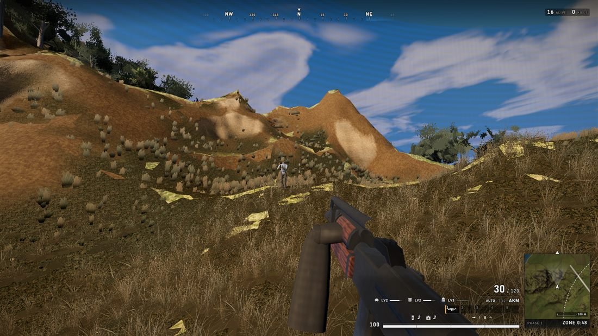
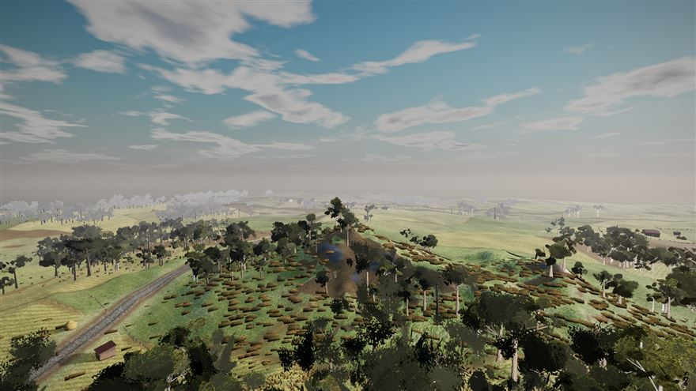
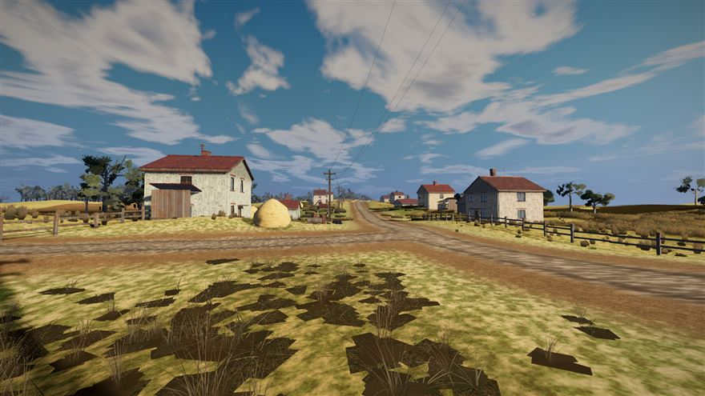
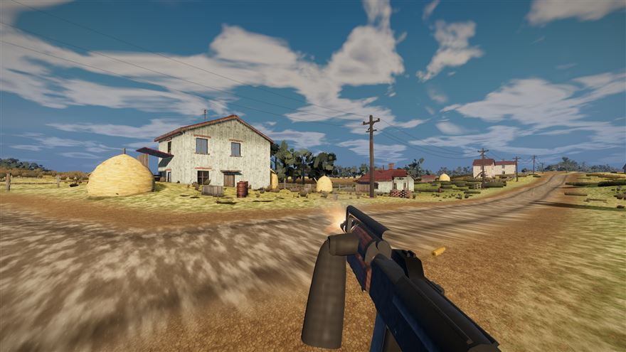

# ERANGEL-web

A fully procedural battle-royale FPS that runs in the browser. Built overnight in a single
autonomous session by Claude (one Fable 5 orchestrator directing 79 Opus 5 sub-agents), from
one prompt: *"build a first-person shooter at the level of the most recent PUBG games."*

**Zero downloaded assets.** Every texture, building, tree, character, weapon and sound is
generated in code at load time - shader-baked PBR texture sets, procedural geometry kits,
synthesized WebAudio. The whole world is deterministic from a single seed.



## What it is

- 1.2 km procedural island: farmland parcels, wooded hills, coast, road network
- 16-player battle-royale match against AI bots (patrol / hear / engage / flee-the-zone)
- Full gunplay: PUBG-style recoil patterns, bullet drop, tracers, hit zones, damage falloff
- Shrinking blue zone, ground loot, win condition, kill feed
- Synthesized audio: layered gunshots, bullet whiz-bys, footsteps by surface, zone drone
- CPU-baked cartographic minimap plus an M-key tactical map with live zone circles
- Target hardware: Intel HD 620 class integrated graphics, WebGL2

| | |
|---|---|
|  |  |



## Run it

```bash
npm install
npm run dev        # dev server
# or a production build:
npm run build && npm run preview
```

Click to deploy. WASD move, Shift sprint, RMB aim, LMB fire, R reload, F pick up,
C crouch, Q/E lean, M map.

## How it was built

The interesting part of this repo is as much the pipeline as the game:

- `tools/capture.mjs` - screenshot harness that drives the real GPU (ANGLE D3D11) headlessly,
  with a SwiftShader tripwire so software rendering can never fake a benchmark
- `tools/gate.mjs` - mechanical quality gate: typecheck, build, 30 fps floor, draw-call budget
- `tools/playtest.mjs` - 11-assertion scripted end-to-end playtest of the whole BR loop
- `management/workflows/wow-loop.js` - the quality loop that built the visuals: an executor
  agent improves one visual stream, captures screenshots, and a panel of three fresh critics
  judges each frame blind beside real PUBG stills, feeding severity-tagged findings into the
  next cycle
- `src/gen/` - the procedural generators: periodic-noise GPU texture factory, heightfield with
  roads and farm parcels, building kit, tree/grass atlases, character rigs, audio synthesis
- `CLAUDE.md` - the earned-knowledge file: every debugged root cause became a standing rule
  for all later agents (GLSL reserved words, tone-mapping pitfalls, shadow-pass culling,
  texture-unit budgets)

Six visual streams (terrain, vegetation, buildings, weapon viewmodel, characters, HUD) ran
these loops in parallel file-lanes of one working tree while the orchestrator built the
gameplay systems directly. One night: 23 cycles, roughly 60 blind critiques, 1.55 billion
tokens processed.

## Honest state

This is a paused work in progress, not a finished game. Known gaps: no visual stream has yet
satisfied its critic panel, a vegetation ground-carpet bug shows in some fields, and the
performance pass has not run so frame rates exceed the intended budget on the target GPU.

## Disclaimer

Fan homage, not affiliated with or endorsed by KRAFTON/PUBG Studios. PUBG: BATTLEGROUNDS is
their game and trademark; this project references it as inspiration only. Every asset in this
repository is procedurally generated - nothing was extracted from or copied out of any game.
No license has been chosen yet; all rights reserved for now.
